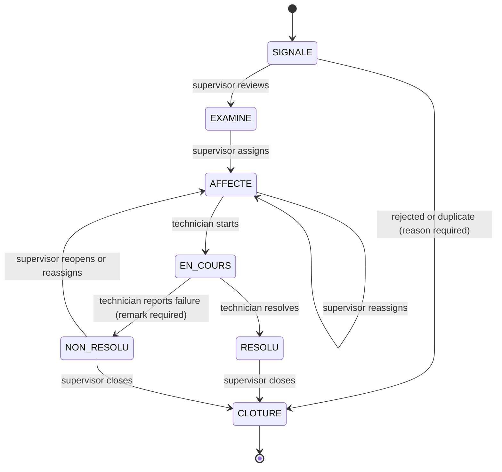
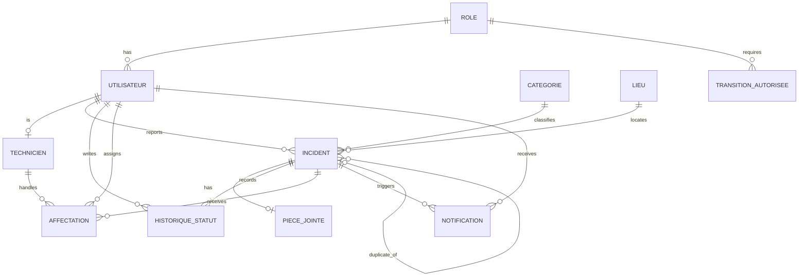

# Incident Management Platform

Web application to report, assign, process and track technical incidents on a school campus, from the first report to closure.

> **Status:** work in progress. Academic project for the module *Gestion de projets & Génie logiciel*.

## Contents

- [Overview](#overview)
- [Scope](#scope)
- [Domain language](#domain-language)
- [Incident lifecycle](#incident-lifecycle)
- [Architecture](#architecture)
- [Tech stack](#tech-stack)
- [Getting started](#getting-started)
- [Project structure](#project-structure)
- [Data model](#data-model)
- [Quality and security](#quality-and-security)
- [Git workflow](#git-workflow)
- [Milestones](#milestones)
- [Team](#team)

## Overview

Equipment and infrastructure (computer rooms, projectors, network, printers, technical furniture) are used daily by students and teachers. Today an incident is reported informally (verbally, by message or by e-mail), with no defined process and no history.

This platform centralises reports, structures their handling and makes every incident traceable and measurable end to end.

| Objective | Success indicator |
|---|---|
| Centralise all reports | 100% of incidents entered through the application |
| Make reporting easy | Report form completed in under 2 minutes |
| Speed up assignment | Review and assignment in at most 3 clicks |
| Guarantee traceability | Every status change timestamped and recorded |
| Support decision-making | Dashboard with at least 4 indicators |
| Deliver a reliable product | No blocking defect at acceptance |

## Scope

**In scope:** authentication and roles, incident report with an optional photo, review/validation/rejection/assignment by the supervisor, handling by the technician, tracking with history and notifications, dashboard and statistics, administration of users, categories and locations, documentation.

**Out of scope:** native mobile app, spare-parts stock and purchasing, invoicing and external maintenance contracts, integration with an existing ticketing system or directory, automatic scheduling of interventions.

## Domain language

The team shares one vocabulary. Code, commits and pull requests are written in English. Domain terms and database identifiers (for example `statut`, `historique_statut`) stay in French, as agreed in the specification.

| Term | English | Meaning |
|---|---|---|
| incident | incident | A reported technical problem |
| déclarant | reporter | The student or teacher who reports it |
| superviseur | supervisor | Reviews, assigns, reassigns and closes incidents |
| technicien | technician | Handles the incidents assigned to them |
| administrateur | administrator | Manages accounts, roles, categories and locations |

Statuses: `SIGNALE`, `EXAMINE`, `AFFECTE`, `EN_COURS`, `RESOLU`, `NON_RESOLU`, `CLOTURE`.

## Incident lifecycle



A closed incident can no longer be modified. Open question: allow `EN_COURS` to `AFFECTE` so a supervisor can reassign when a technician becomes unavailable.

## Architecture

```
Browser
   | HTTPS
   v
Front-end          pages, forms, dashboard
   | HTTP + JSON
   v
REST API           authentication, role permissions, workflow
   | SQL (restricted application account)
   v
PostgreSQL         schema, constraints, triggers, backups
```

## Tech stack

| Layer | Choice |
|---|---|
| Database | PostgreSQL 16 |
| Local environment | Docker Compose |
| Version control | Git and GitHub (`main`, `dev`, pull requests) |
| Back-end | To be decided (Node.js/Express, Laravel or Spring Boot) |
| Front-end | To be decided (React or Vue.js) |
| Hosting | Free tiers only (zero budget) |

## Getting started

**Prerequisites:** Windows with WSL2 (Ubuntu), Docker Desktop with WSL integration enabled, Git.

> The database commands below work once the database layer has been merged into `dev`.

```bash
git clone git@github.com:ouhaddousara/incident-management-platform.git
cd incident-management-platform
cp .env.example .env          # then set your own local passwords
docker compose up -d          # start PostgreSQL
docker compose ps             # the db service should be "healthy"
```

Run the business-rule tests:

```bash
docker compose exec -T db psql -U helpdesk_owner -d helpdesk -v ON_ERROR_STOP=1 < db/tests/test_rules.sql
```

Reset the database to a clean state with demo data:

```bash
./scripts/reset_db.sh
```

Back up and test a restore:

```bash
./scripts/backup.sh
./scripts/restore_test.sh backups/<file>.dump
```

Init scripts in `db/init` only run when the database volume is created. After editing one, run `docker compose down -v && docker compose up -d`.

## Project structure

```
.
├── backend/        REST API
├── frontend/       web application
├── db/
│   ├── init/       numbered SQL scripts (schema, rules, grants, seed)
│   └── tests/      SQL tests for the business rules
├── scripts/        backup, restore, reset, user provisioning
├── site/           landing page
├── docs/           UML, user manual, annexes
├── tests/          performance tests
├── docker-compose.yml
└── .env.example
```

## Data model



Design principles:

- Rules that protect data integrity live in the database, so no application bug can break them: one active assignment per incident (partial unique index), mandatory remark for `NON_RESOLU`, immutable history, frozen closed incidents.
- Status changes only happen by inserting a row in `historique_statut`. A trigger validates the transition against `transition_autorisee` and updates `incident.statut`.
- The API handles fine-grained read permissions, input validation and notifications.

## Quality and security

| Topic | Target |
|---|---|
| Performance | 95% of pages under 3 s with 50 concurrent users |
| Availability | Reachable during the acceptance period |
| Reliability | Daily database backup, 7 days retained, restore tested |
| Security | Hashed passwords, role-based access, HTTPS, parameterised queries |

- Secrets never go to Git. `.env` is ignored, `.env.example` documents the variables.
- The database port is bound to `127.0.0.1`.
- The application account has no `DELETE` right and cannot modify the history.
- Demo accounts (`db/init/05_seed_demo.sql`) are for local development only and are never loaded on a hosted platform.

## Git workflow

| Branch | Purpose | Rules |
|---|---|---|
| `main` | Stable, deliverable versions, tagged | Protected. Updated only by pull request from `dev` at milestones |
| `dev` | Integration of everyone's work | Protected. Updated only by reviewed pull requests |
| `feature/<topic>` | One focused piece of work | Created from `dev`, deleted after merge |

> Branch protection rules are not enforced on private repositories with the free GitHub plan. The rules below are a team convention: never push directly to `main` or `dev`, always open a pull request reviewed by another member.

1. `git switch dev && git pull`
2. `git switch -c feature/<topic>`
3. Commit in small, coherent steps.
4. Push and open a pull request to `dev`, reviewed by another member.
5. **Squash and merge** into `dev`.
6. At a milestone, open a pull request `dev` to `main` (**merge commit**, not squash), then tag it.

Commits follow [Conventional Commits](https://www.conventionalcommits.org): `type(scope): subject`, in the imperative mood, 72 characters at most, no trailing period.

Types: `feat`, `fix`, `docs`, `test`, `build`, `ci`, `chore`, `refactor`.

Examples: `feat(db): add core schema`, `fix(db): reject assignment to unavailable technicians`.

## Milestones

| Step | Date | Deliverables |
|---|---|---|
| 3. Structuring | 8 Nov 2026 | Roles, specification |
| 4. Supplier kick-off | 10 Nov 2026 | Framing note, platform with guest client, kick-off meeting |
| 5. Planning | 15 Nov 2026 | Life cycle, WBS, Gantt, PERT, budget, risk register |
| 6. Progress review | 16 Nov 2026 | Report, updated Gantt, Pareto analysis |
| 7. Delivery and acceptance | 23 Nov 2026 | Delivered product, client validation |
| 8. Final submission | 30 Nov 2026 | Complete file on Classroom |

## Team

| Role | Member |
|---|---|
| Project manager | Alaa |
| Back-end | Adnane |
| Front-end | Mahamed |
| Database & DevOps | Sara |
| QA / Testing | Acher |
| Documentation / UML | Abderrahmane |

## License

Academic project. No license is granted.
